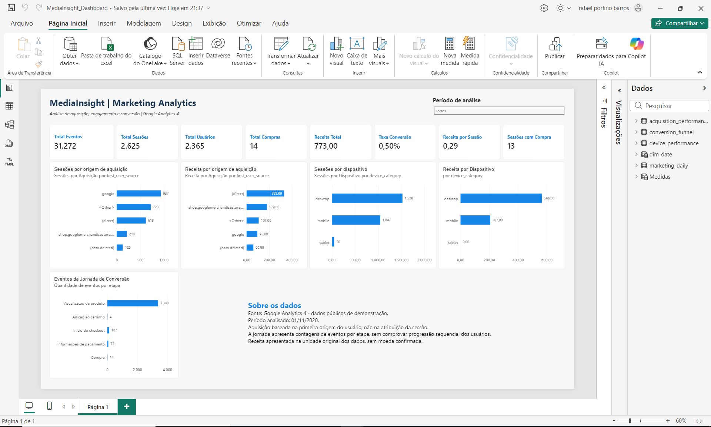

# MediaInsight - Dashboard Power BI

## 1. Objetivo

O dashboard MediaInsight foi desenvolvido para apoiar a análise de aquisição, engajamento e conversão em um ambiente de comércio eletrônico.

O relatório utiliza dados processados por um pipeline de Engenharia de Dados desenvolvido em Python, SQL e DuckDB.

## 2. Arquitetura dos dados

O fluxo de processamento segue as etapas:

**GA4 (CSV) → Bronze → Silver → Gold → Exportação CSV → Power BI**

- **Bronze:** armazenamento dos eventos extraídos da fonte.
- **Silver:** transformação, padronização e validação dos registros.
- **Gold:** construção das tabelas analíticas.
- **Power BI:** modelagem semântica, medidas DAX e visualização dos indicadores.

## 3. Fonte e período

- Fonte: Google Analytics 4 - dados públicos de demonstração.
- Período analisado: 01/11/2020.
- Eventos processados: 31.272.

O conjunto de dados utilizado contém apenas um dia. Portanto, o dashboard não permite avaliar tendências mensais, sazonalidade ou evolução temporal.

## 4. Tabelas analíticas

| Tabela | Finalidade |
|---|---|
| `marketing_daily` | Indicadores gerais de marketing |
| `acquisition_performance` | Desempenho por origem de aquisição |
| `device_performance` | Desempenho por dispositivo |
| `conversion_funnel` | Contagens de eventos por etapa da jornada |
| `dim_date` | Dimensão de calendário criada no Power BI |
| `Medidas` | Organização das medidas DAX |

## 5. Indicadores principais

| Indicador | Resultado |
|---|---:|
| Total de eventos | 31.272 |
| Total de sessões | 2.625 |
| Total de usuários | 2.365 |
| Total de compras | 14 |
| Sessões com compra | 13 |
| Receita total | 773,00 |
| Taxa de conversão por sessão | 0,50% |
| Receita por sessão | 0,29 |

A taxa de conversão utiliza sessões com compra divididas pelo total de sessões.

A receita está apresentada na unidade original dos dados, sem moeda confirmada.

## 6. Visualizações

O relatório contém:

1. Sessões por origem de aquisição.
2. Receita por origem de aquisição.
3. Sessões por dispositivo.
4. Receita por dispositivo.
5. Eventos da jornada de conversão.

Também apresenta oito cartões de indicadores e um filtro de período.

## 7. Regras de negócio e limitações

**Aquisição:** a classificação utiliza a primeira origem do usuário (`first_user_source`), não a atribuição da sessão.

**Jornada de conversão:** os valores representam contagens de eventos por etapa. Não constituem necessariamente um funil sequencial de usuários.

**Interações:** foram ajustadas para evitar interpretações incorretas entre tabelas Gold agregadas por dimensões diferentes.

**Período:** os dados abrangem somente 01/11/2020.

**Receita:** a moeda não foi confirmada na fonte utilizada.

## 8. Validação

Foram realizados testes de consistência entre os indicadores do Power BI e os resultados da camada Gold.

Também foram verificadas:

- Reconciliação das sessões por dispositivo.
- Reconciliação da receita por dispositivo.
- Funcionamento do filtro de período.
- Interações entre gráficos.
- Formatação dos indicadores e visualizações.

## 9. Evidência visual

## 10. Conclusão

O MediaInsight demonstra a integração entre Engenharia de Dados e Business Intelligence, desde a preparação e validação dos dados até sua apresentação em indicadores de negócio.

O projeto também evidencia a importância da documentação de regras de negócio, reconciliação de métricas e comunicação das limitações analíticas.